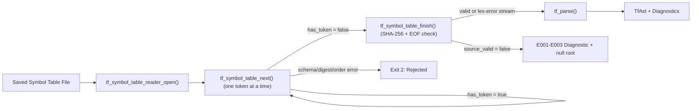
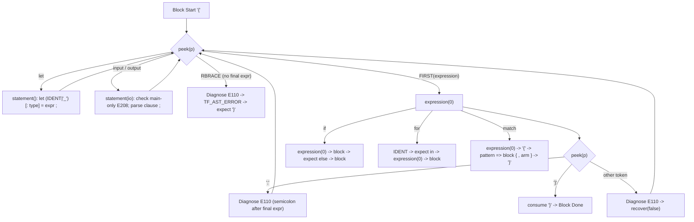
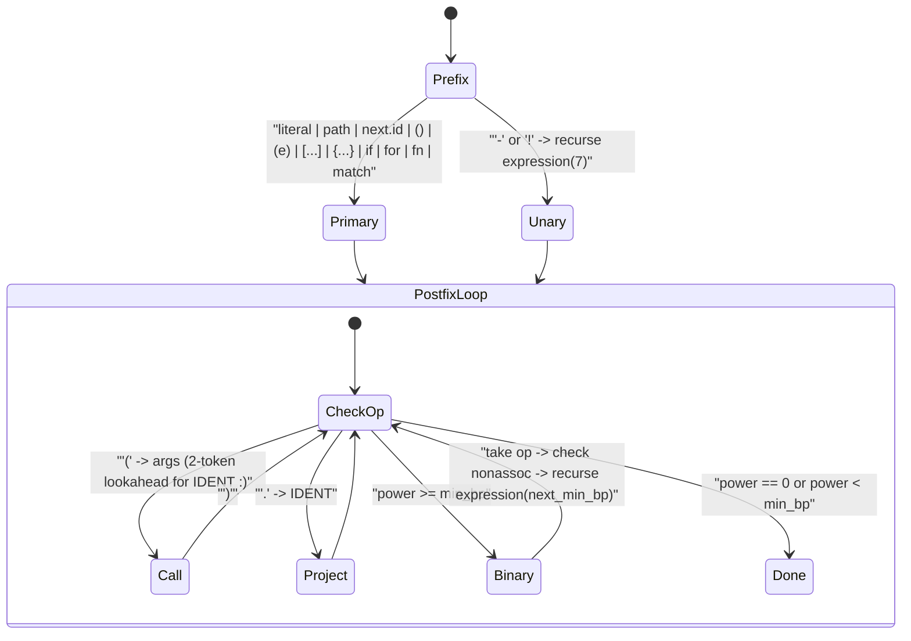

# Parser transition diagrams

The diagrams below map the actual control transitions in `src/symbol_table.c` and `src/parser.c`. Comments (`TF_COMMENT_LINE`, `TF_COMMENT_BLOCK`) are skipped automatically by `peek()` between any two parser states.

## 1. End-to-end pipeline (Symbol Table input to AST)

## 2. Module and top-level declaration dispatch (`parse_module`, `declaration`)

```mermaid
stateDiagram-v2
    [*] --> ModuleStart
    ModuleStart --> ImportDecl : "import"
    ModuleStart --> DeclPub : "pub"
    ModuleStart --> DeclFn : "fn"
    ModuleStart --> DeclRecord : "record"
    ModuleStart --> DeclEnum : "enum"
    ModuleStart --> DeclMachine : "machine"
    ModuleStart --> TopRecover : "other token (E110)"
    ModuleStart --> [*] : "EOF"

    ImportDecl --> ModuleStart : "STRING as IDENT ;"
    DeclPub --> DeclFn : "fn"
    DeclPub --> DeclRecord : "record"
    DeclPub --> DeclEnum : "enum"
    DeclPub --> DeclMachine : "machine"
    DeclPub --> ImportDecl : "import (E110)"
    DeclFn --> ModuleStart : "IDENT params -> type block"
    DeclRecord --> ModuleStart : "IDENT { fields }"
    DeclEnum --> ModuleStart : "IDENT { variants }"
    DeclMachine --> ModuleStart : "IDENT ( param ) yields type rejects type { sections }"
    TopRecover --> ModuleStart : "recover(true) at boundary"
```

## 3. Block statements, conditionals, loops, and match (`block`, `statement`, `primary`)

## 4. Pratt expression and postfix loop (`expression`, `binding_power`)

